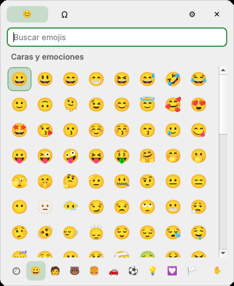
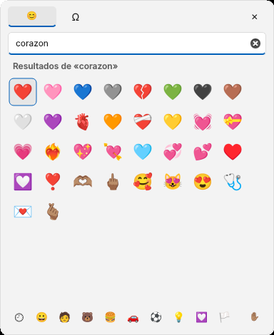
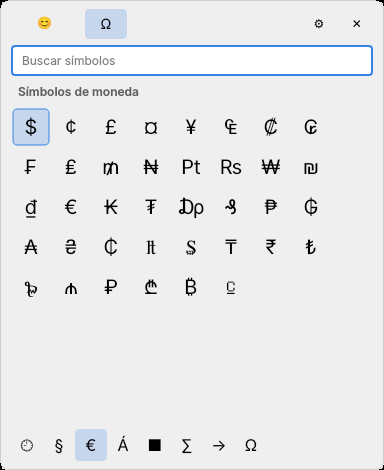

# Emon: panel de emojis para Linux y macOS

El panel de emojis de Windows, en Linux y en Mac. Pulsa **Super + .** en Linux
(o **⌃⌘.** en Mac) en cualquier aplicación, busca el emoji y pulsa Enter: se
escribe donde estabas.

- **Todos los emojis de Unicode 18.0** (septiembre de 2026), ordenados por
  categorías como en Windows: caras, personas, animales, comida, viajes,
  actividades, objetos, símbolos y banderas.
- **Búsqueda en tu idioma y en inglés.** Con Linux en español encuentras
  «corazón» y también «heart». Sin tildes también vale: «corazon». Los nombres
  vienen de Unicode CLDR 49 y hay 144 idiomas.
- **Usados recientemente**, guardados entre sesiones.
- **Tonos de piel**: el botón ✋ de abajo a la derecha cambia el tono de todas las
  personas y manos. Con clic derecho sobre un emoji eliges el tono solo para esa vez.
- **Pestaña de símbolos** (Ω): puntuación, moneda, letras latinas, geométricos,
  matemáticos, flechas y letras griegas y cirílicas.
- Solo enseña los emojis que tu fuente sabe dibujar: nunca verás cajas vacías.

Funciona en **KDE Plasma, GNOME, Cinnamon y XFCE**, en X11 y Wayland, en
Hyprland, Sway y niri, y en **macOS 12 o más reciente** (Apple Silicon e Intel).

El panel toma los colores de tu escritorio. De izquierda a derecha: Zorin OS
con el tema verde claro, Zorin OS oscuro y el tema por defecto.

| Emojis por categorías | Búsqueda en español | Símbolos |
| --- | --- | --- |
|  |  |  |

## Instalación y primeros pasos

Elige tu sistema, copia los comandos en la terminal y sigue los pasos. En todos
los casos el último paso es el mismo: **abrir Emon una vez**.

### Debian, Ubuntu, Linux Mint, Pop!\_OS y Zorin OS

1. Instala (copia las dos líneas en la terminal):

   ```sh
   wget -O /tmp/emon.deb https://github.com/anrennnn/Emon-Linux-MacOS/raw/main/instalador/emon_0.3.0_all.deb
   sudo apt install /tmp/emon.deb
   ```

2. Ábrelo una vez: pulsa la tecla Super (la de Windows), escribe **Emon** y
   ábrelo. Esa primera vez configura el atajo y se queda en marcha; desde
   entonces arranca solo al iniciar sesión.
3. Pulsa **Super + .** en cualquier sitio donde escribas, busca el emoji y haz
   clic o pulsa Enter.
4. **Solo en GNOME o KDE con Wayland** (lo normal en Ubuntu, Zorin y Pop!\_OS):
   la primera vez que elijas un emoji, el escritorio te preguntará si Emon
   puede **controlar el teclado** («Permitir control remoto» o parecido). Acepta:
   es lo que permite que el emoji se pegue solo, igual que en Windows.

Funciona desde Ubuntu 22.04 (Linux Mint 21, Zorin OS 17, Pop!\_OS 22.04).

> ¿apt dice «Se ha suministrado el fichero no admitido»? Es que el archivo no
> está en la carpeta donde estás. Usa los comandos de arriba, o entra antes en
> la carpeta de descargas: `cd ~/Descargas`.

### Fedora y Nobara

1. Instala:

   ```sh
   sudo dnf install https://github.com/anrennnn/Emon-Linux-MacOS/raw/main/instalador/emon-0.3.0-1.noarch.rpm
   ```

2. Ábrelo una vez desde el menú de aplicaciones (**Emon**).
3. Pulsa **Super + .** en cualquier sitio donde escribas.
4. Fedora usa Wayland: la primera vez que elijas un emoji, acepta el permiso
   para controlar el teclado que pide el escritorio.

### Arch Linux, CachyOS, EndeavourOS y Manjaro

1. Instala:

   ```sh
   curl -LO https://github.com/anrennnn/Emon-Linux-MacOS/raw/main/instalador/emon-0.3.0-1-any.pkg.tar.zst
   sudo pacman -U emon-0.3.0-1-any.pkg.tar.zst
   ```

   o desde el código: `git clone https://github.com/anrennnn/Emon-Linux-MacOS && cd Emon-Linux-MacOS/packaging/arch && makepkg -si`.

2. Ábrelo una vez desde el menú de aplicaciones (**Emon**).
3. Pulsa **Super + .** en cualquier sitio donde escribas. En KDE Plasma (lo que
   trae CachyOS) acepta el permiso para controlar el teclado la primera vez.
4. En **Hyprland, Sway o niri**, al abrirlo te dirá qué línea añadir a tu
   configuración para el atajo (ver más abajo), e instala `wtype`
   (`sudo pacman -S wtype`) para que el emoji se escriba solo.

### macOS

1. Descarga el `.dmg` de tu Mac desde la versión
   [«Emon para macOS»](https://github.com/anrennnn/Emon-Linux-MacOS/releases/tag/macos):
   `arm64` para Apple Silicon (M1, M2, M3, M4…) y `x86_64` para Mac con Intel.
2. Ábrelo y arrastra **Emon** a **Aplicaciones**.
3. Abre Emon. La primera vez, macOS dirá que no puede verificar la app (no
   está firmada por Apple): ve a **Ajustes del Sistema → Privacidad y
   seguridad**, baja hasta «Emon se bloqueó» y pulsa **Abrir igualmente**.
4. Activa Emon en **Ajustes del Sistema → Privacidad y seguridad →
   Accesibilidad**, para que el emoji se escriba solo en la otra app.
5. Pulsa **⌃⌘.** (Control + Comando + punto) en cualquier sitio donde escribas.

Emon no tiene icono en el Dock y se abre solo al iniciar sesión. ⌘. no se
usa porque en macOS significa «cancelar» en todas las apps.

### ¿Tenías instalado «Emojis»?

Hasta la versión 0.2 la app se llamaba **Emojis** (paquete `emojis-linux`).
Instala Emon con los mismos comandos de arriba: sustituye a la anterior,
conserva tus emojis recientes, el tono de piel y tu atajo, y cambia los atajos
del escritorio al nombre nuevo. En Mac, borra `Emojis.app` de Aplicaciones
después de instalar `Emon.app`, y vuelve a dar el permiso de Accesibilidad a Emon.

### Si algo no funciona

- **Super + . no hace nada:** escribe `emon atajos` en la terminal; te
  dirá qué ha configurado. También puedes elegir otro atajo con ⚙ (ver «Cambiar
  el atajo»).
- **El emoji se copia pero no se pega solo:** en GNOME o KDE con Wayland, es que
  no se aceptó el permiso de controlar el teclado. Cierra Emon
  (`emon salir`), vuelve a abrirlo y acéptalo al elegir el siguiente
  emoji. Mientras tanto, pégalo con Ctrl + V.
- **En una terminal** el emoji no se pega con Ctrl + V (las terminales usan
  Ctrl + Mayús + V): pégalo a mano o usa una sesión X11.

## Uso

| Tecla | Qué hace |
| --- | --- |
| Super + . o Super + ; (Mac: ⌃⌘. o ⌃⌘;) | Abre el panel (si ya está abierto, lo cierra) |
| Escribir | Busca al instante |
| Flechas | Moverse entre los emojis |
| Enter o clic | Escribe el emoji y cierra el panel |
| Clic derecho | Elegir el tono de piel para ese emoji |
| Esc o clic fuera | Cierra el panel |
| ⚙ (arriba a la derecha) | Cambiar el atajo de teclado |

### Cambiar el atajo

Pulsa ⚙ en el panel, o busca «Cambiar el atajo de teclado» en el menú de
aplicaciones (clic derecho sobre Emon), o escribe `emon ajustes`. Haz
clic en el cuadro, pulsa la combinación que quieras (por ejemplo Ctrl + Alt + E)
y pulsa **Guardar**. Emon la pone en tu escritorio y quita la anterior.
**Restaurar predeterminado** vuelve a Super + . y Super + ; (⌃⌘. y ⌃⌘; en Mac).

Desde la terminal:

```sh
emon abrir       # abrir el panel
emon simbolos    # abrir en la pestaña de símbolos
emon ajustes     # elegir otro atajo de teclado
emon atajos      # volver a poner el atajo elegido en el escritorio
emon salir       # detener el proceso de fondo
emon version
```

## Cómo se escribe el emoji en la otra aplicación

Windows lo hace con su propio sistema de entrada de texto. En Linux depende de
la sesión:

| Sesión | Qué pasa | Necesita |
| --- | --- | --- |
| X11 (cualquier escritorio) | Se escribe directamente; el portapapeles no se toca | `xdotool` (se instala solo) |
| Wayland: Hyprland, Sway, niri, Wayfire | Se escribe directamente | `wtype` |
| Wayland: GNOME y KDE Plasma | Se pega solo; después el portapapeles vuelve a tener lo que había | Aceptar el permiso de controlar el teclado (una vez) |
| macOS | Se escribe directamente | Permiso de Accesibilidad |

GNOME y KDE en Wayland no dejan, por diseño, que un programa teclee en la
ventana de otro. Emon usa la vía oficial, el portal *RemoteDesktop*: el
escritorio pregunta una vez si Emon puede controlar el teclado y, a partir de
ahí, Emon copia el emoji, pulsa Ctrl + V por ti y deja el portapapeles como
estaba. En escritorios recientes el permiso se recuerda; en los más antiguos
(GNOME 42–45) se vuelve a pedir una vez por sesión.

Si prefieres no usar el portal, `ydotool` con su servicio activo también vale:

```sh
sudo apt install ydotool        # o: sudo dnf install ydotool / sudo pacman -S ydotool
systemctl --user enable --now ydotool
```

## Aspecto

El panel usa los colores de tu escritorio, no los de Windows: claro u oscuro
según tu tema, el color de acento de tu sistema (por ejemplo el azul o el verde
de Zorin, el acento de GNOME o el de KDE y macOS) y las esquinas redondeadas de
cada escritorio. Si cambias el tema, el panel lo sigue la próxima vez que lo
abras.

## Atajos en cada escritorio

Al primer arranque, Emon configura Super + . y Super + ; él solo (o el atajo
que elijas con ⚙):

- **GNOME**: dos atajos personalizados en Configuración → Teclado.
- **KDE Plasma**: el selector de emojis de KDE ya usa Meta + .; se le cambia a
  Meta + Ctrl + Alt + Mayús + Espacio y Emon se queda con Meta + . y Meta + ;.
- **Cinnamon y XFCE**: atajos personalizados.
- **Hyprland, Sway y niri**: Emon te dice qué línea añadir a tu configuración:

  ```
  bind = SUPER, period, exec, emon abrir          # Hyprland
  bindsym Mod4+period exec emon abrir             # Sway
  Mod+Period { spawn "emon" "abrir"; }            # niri
  ```

## Emojis nuevos y fuentes

Los dibujos los pone la fuente de emojis del sistema (Noto Color Emoji en
Linux, Apple Color Emoji en Mac). Emon
incluye la lista completa de Unicode 18.0, pero solo enseña los que tu fuente
sabe dibujar, para que nunca veas cajas vacías. Los más nuevos (los 9 de
Unicode 18.0: cara agrietada, mariposa monarca, pepinillo, faro, meteorito,
goma de borrar, red, y pulgares hacia la izquierda y hacia la derecha)
aparecerán solos en cuanto tu distribución actualice la fuente. No hace falta
actualizar Emon.

## Para desarrolladores

Python 3.10+ y PyQt6. En Linux el código se instala en `/usr/lib/emon` y
no en `site-packages`, así sigue funcionando cuando la distribución actualiza
Python. Lo propio de macOS está en `src/emon/macos.py` (atajo global con
Carbon, escritura con Quartz) y usa PyObjC.

```sh
PYTHONPATH=src python3 -m emon abrir   # probar sin instalar
./build-deb.sh                                  # dist/*.deb
./build-rpm.sh                                  # dist/*.rpm (necesita rpmbuild)
./build-arch.sh                                 # dist/*.pkg.tar.zst (necesita Docker)
macos/construir.sh                              # dist/*.dmg (en un Mac)
```

En cada cambio a `main`, GitHub Actions construye los `.dmg` en Macs reales
(Apple Silicon e Intel), comprueba que la app arranca y abre el panel, y los
publica en la versión «macos» junto con una captura de la prueba.

Los datos de `src/emon/datos` se generan con
`herramientas/generar_datos.py` a partir de `emoji-test.txt` de Unicode y de los
paquetes `cldr-annotations-full` y `cldr-annotations-derived-full`.

## Licencia

MIT. Los datos de emojis y nombres son de Unicode, Inc., con la licencia
[Unicode License v3](LICENSE-UNICODE).
